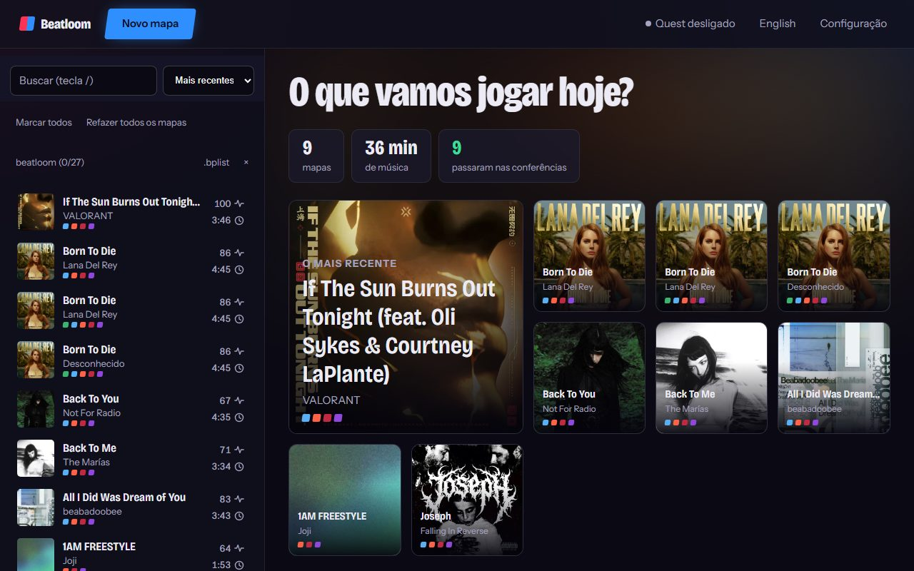

# Beatloom

[English](README.md) · [Baixar](https://github.com/bps2414/beatloom/releases/latest) · [Como funciona](docs/ARCHITECTURE.pt-BR.md) · [Roadmap](docs/ROADMAP.md)

**Cole um link do YouTube e receba um mapa de Beat Saber pronto para jogar.**



O Beatloom ouve a música e monta o mapa (Easy, Normal, Hard, Expert e Expert+) com regras e com padrões tirados de mapas humanos bem avaliados. Nenhum modelo é treinado. Tudo roda no seu computador, numa página local: você assiste ao mapa em 3D, confere o relatório e manda para o Quest pelo Wi-Fi.

Projeto de hobby, não oficial, sem ligação com a Beat Games.

## Começar

1. Baixe o `beatloom-setup.exe` da [última release](https://github.com/bps2414/beatloom/releases/latest) e abra. Não precisa instalar nada antes nem ter conta de administrador.
2. Espere o preparo da primeira vez. A página mostra o que falta e baixa com barra de progresso.
3. Clique em **Novo mapa**, cole um link do YouTube (ou escolha um arquivo de áudio) e gere.

O instalador não é assinado, então o Windows mostra "O Windows protegeu o computador". Clique em "Mais informações" e depois em "Executar assim mesmo". Se preferir, baixe o zip do código na mesma release, descompacte e dê dois cliques em `start.bat`: é a mesma coisa, sem os atalhos.

### O que é baixado na primeira vez

Tudo vai para dentro da pasta do Beatloom (`%LOCALAPPDATA%\Beatloom`). Desinstalar ou apagar a pasta remove tudo; o desinstalador pergunta se os mapas gerados ficam.

| O quê | Tamanho e tempo | Obrigatório |
|---|---|---|
| Python 3.12 e os pacotes | uns 2 GB, vários minutos | sim |
| ffmpeg e Node.js | pequeno | sim |
| Biblioteca de padrões: as notas (sem áudio) de 1000 mapas bem avaliados do BeatSaver | uns 20 minutos, um pedido por segundo; se você fechar, continua de onde parou | sim |
| [ArcViewer](https://github.com/AllPoland/ArcViewer) (GPL-3), o visualizador 3D da página | uns 80 MB | não |
| ADB, para mandar mapas ao Quest | pequeno | não |

A biblioteca de padrões não vem no repositório nem na release porque deriva do trabalho de outros mappers. Em PC com placa NVIDIA o `start.bat` instala o torch com CUDA; nos outros, o de processador.

## Na página

A página abre em http://localhost:8777, em português ou inglês, e só responde ao seu próprio computador.

- **Novo mapa.** Antes de gerar você vê a capa, o nome e o artista para corrigir, e escolhe as dificuldades e a quantidade de notas.
- **Playlist.** O link pode ser de uma playlist do YouTube: cada faixa entra na fila e vira um mapa. Colar a mesma playlist de novo não repete o que já foi feito.
- **Playlist no jogo.** Com um link de playlist, marque "Criar também a playlist no jogo": os mapas aparecem agrupados no Beat Saber, com o nome da playlist. Precisa de um mod de playlists (PlaylistManager) no Quest. A playlist vai junto quando você manda os mapas; sem Quest conectado, baixe o `.bplist` pela lista. Ainda não foi testado num Quest de verdade.
- **Fila.** Dá para pausar, esvaziar e tirar um item. Ela é guardada em disco: fechar o Beatloom não a perde.
- **Ficha do mapa.** Visualizador 3D, os números de cada dificuldade e o resultado da conferência. Dá para renomear, baixar o zip, refazer e apagar (vai para `saida\lixeira`).
- **Seu jeito de jogar** (em Configuração). Sem notas na linha de cima, sem nota escondida atrás de outra, quanto os braços podem cruzar (nunca, pouco, livre) e sabres e notas com as cores da capa.
- **Refazer os mapas.** Marque mapas na lista e refaça com o gerador e as preferências de agora, ou use "Refazer todos os mapas". Nome, artista, capa e dificuldades ficam; a versão anterior vai para `saida\versoes`. Com a análise guardada leva uns 10 segundos por mapa.
- **Modo rápido.** Umas 6 vezes mais rápido, sem separar os instrumentos, então sem notas seguradas e sem paredes.
- **Mods, opcionais.** "Tenho Chroma" põe a paleta da capa nas luzes. "Tenho Noodle Extensions" acrescenta um conjunto de dificuldades à parte (Lawless) com efeitos leves. Desligadas, o mapa sai sem depender de mod nenhum.

### Quest

Na primeira vez, ligue o headset pelo cabo USB com o modo desenvolvedor ativado, aceite o aviso que aparece dentro dele e clique em "Encontrar o Quest pelo cabo USB" na Configuração. Depois disso os mapas vão pelo Wi-Fi. A página mostra se o Quest está alcançável, quais mapas já estão nele e quais mudaram desde o envio, manda vários de uma vez e apaga do headset.

Sem Quest: copie a pasta descompactada do zip para a pasta de mapas personalizados do SongCore.

## O que o mapa tem

| | |
|---|---|
| Ritmo | Batidas e compassos pelo [beat_this](https://github.com/CPJKU/beat_this), ataques pelo librosa na música e em cada instrumento separado pelo [Demucs](https://github.com/adefossez/demucs) (bateria, baixo, voz, resto). Eventos de BPM quando o andamento varia. |
| Golpes | Trechos de 1, 2 e 4 batidas cortados de mapas humanos, escolhidos ensaiando 8 batidas à frente e mantendo a paridade (o pulso nunca é forçado a torcer). Refrão repete o desenho, às vezes espelhado. |
| Voz e bateria | Sílaba cantada vira nota, a altura da voz puxa a linha e o sentido do corte, nota longa vira nota segurada. Bumbo embaixo, caixa no meio, prato forte vira dupla. |
| Vocabulário | Arcos, correntes nos ataques secos, pilhas nos acentos, bombas de reinício na volta dos respiros, paredes de enfeite, de desviar e de agachar. |
| Luzes | Seguem as partes da música (introdução, verso, subida, queda, pausa) e a bateria, com as cores da capa, num cenário escolhido pelo clima da música. |
| Dados | Capa, nome, artista, álbum, ano e link que vierem do arquivo ou do vídeo. |

Todo mapa sai com um relatório. Ele confere: formato válido ([bsmap](https://github.com/KivalEvan/BeatSaber-JSMap)), erros de paridade, bloqueios de visão, palmas (mãos se batendo), notas empilhadas, sabre de uma mão passando pela nota da outra, notas na batida, folga no começo e no fim, e notas por segundo dentro da faixa de cada dificuldade.

## Até onde foi testado

Sem exagero. Em 18 músicas de estilos diferentes (indie pop, rock, metal, eletrônica), todas passam em todas as conferências automáticas. Passar quer dizer "jogável e sem defeito conhecido", não "divertido". Poucos desses mapas foram jogados no headset.

Limites conhecidos:

- Só grade de 1/4: sem tercinas nem swing. Sem notas de ponto.
- Ainda não vistos no jogo: correntes, bombas, paredes de desviar, as luzes dos cenários novos e os efeitos do Chroma e do Noodle Extensions. O formato é validado, o resultado na tela não.
- Música lenta ganha muitas notas duplas no Expert+ para chegar à densidade alvo.
- O instalador ainda não foi testado numa máquina limpa.
- Feito e testado no Windows. Outros sistemas não são alvo.

Os números de cada mudança do gerador estão em [docs/RESULTADOS.md](docs/RESULTADOS.md).

## Para quem mexe no código

### Instalar à mão

Precisa de Python 3.12, [ffmpeg](https://ffmpeg.org/) e [Node.js](https://nodejs.org/).

```
python -m venv .venv
.venv\Scripts\pip install -r requirements.txt --extra-index-url https://download.pytorch.org/whl/cpu
cd check && npm install && cd ..
.venv\Scripts\python tools\download_maps.py 1000
.venv\Scripts\python tools\extract_patterns.py
git clone --depth 1 -b deploy https://github.com/AllPoland/ArcViewer.git arcviewer
.venv\Scripts\python app.py
```

O `git clone` é opcional (visualizador 3D). Também opcional, só para as etapas 1 e 2 do gerador: Java e o `BeatKenja.jar` do [BeatKenja](https://github.com/Chrisvenator/BeatKenja) em uma pasta `beatkenja`.

### Linha de comando

```
.venv\Scripts\python generate.py "musica.mp3" --nome "Nome" --artista "Artista" --capa "foto.jpg"
```

O mapa sai em `saida\<nome>-v4.zip`, com `.relatorio.txt` e `.relatorio.json` ao lado.

| Opção | O que faz |
|---|---|
| `--nome`, `--artista` | Opcionais. Sem eles valem as tags do arquivo e, na falta, o nome do arquivo ("Artista - Música"). |
| `--capa` | Sem ela vale a imagem embutida no arquivo e, na falta, uma genérica. |
| `--difs Normal,Hard` | Gera só algumas dificuldades. |
| `--densidade 0.8` | De `0.8` a `1.3`: mapa mais leve ou mais cheio. |
| `--prefs sem_topo,sem_fila,cruzar_nunca,sabres_capa,chroma,noodle` | As preferências de "Seu jeito de jogar" (`cruzar_livre` também existe; sem nenhum dos dois, pouco). |
| `--etapa 1\|2\|3\|4` | Versão do gerador (padrão 4): 1 ritmo simples com golpes do BeatKenja, 2 densidade segue a energia e refrões repetem, 3 golpes de padrões humanos, 4 separação de instrumentos e paredes. |

### Ferramentas

| Comando | Para quê |
|---|---|
| `report.py <zip>` | Refaz as conferências de um mapa. |
| `tools\medir.py` | Notas por segundo, cobertura, precisão e correlação dos mapas em `saida\`. Rode antes e depois de mexer no gerador. |
| `tools\blind_test.py <a.zip> <b.zip>` | Par A/B embaralhado da mesma música, para comparar sem saber qual é qual. |
| `tools\batch.py <lista.txt> <pasta>` | Gera várias músicas e resume os relatórios. |
| `tools\timing.py <audio>` | Mede quanto cada etapa da geração demora. |
| `tools\check_i18n.py` | Confere se os dois idiomas têm as mesmas frases. |

Cada módulo tem um teste mínimo: `python generate.py --demo`, `python -m beatloom.engine --demo` e assim por diante (a lista está em [CLAUDE.md](CLAUDE.md)).

### Release

Escreva a seção `## v1.2.0` no [CHANGELOG.md](CHANGELOG.md), faça o commit e suba a tag: `git tag v1.2.0` e `git push origin v1.2.0`. A CI (`.github\workflows\release.yml`) monta o `beatloom-setup.exe` com o Inno Setup (`installer\beatloom.iss`) e publica a release com essa seção e, recolhida, a lista dos commits desde a tag anterior.

A cada push, `.github\workflows\ci.yml` roda os `--demo` e o `tools\check_i18n.py`.

### Colab e Kaggle

Para gerar em lote numa GPU do Google Colab (playlist do YouTube ou uma pasta de áudios do seu Drive), abra [colab/beatloom.ipynb](https://colab.research.google.com/github/bps2414/beatloom/blob/main/colab/beatloom.ipynb). O mesmo caderno roda no Kaggle. Cada pessoa roda na própria conta; não tem a página nem o visualizador. O caderno ainda não foi rodado de verdade lá.

### Pastas

```
start.bat            instala o que falta e abre a página
app.py               servidor local e as rotas /api
generate.py          gera um mapa (linha de comando)
report.py            confere um mapa e escreve o relatório
beatloom\            o miolo: ouvir (audio.py), escolher golpes (engine.py), luzes (luzes.py), mods (mods.py),
                     conferir (checks.py), downloads da primeira vez (preparo.py), Quest por ADB (quest.py)
site\                a página: app.html, app.css, app.js, as frases em i18n\, as fontes
check\               validação de formato com o bsmap (Node)
tools\               biblioteca de padrões, medição, teste cego, lote
installer\           o instalador (Inno Setup)
colab\               o caderno do Colab e do Kaggle
docs\                como funciona, roadmap e o plano do redesenho
```

Fora do repositório, criadas no uso: `bin\`, `arcviewer\`, `dados\`, `musicas\`, `saida\` e `beatloom.json` (suas escolhas).

## Tenha consideração

Os mapas desta ferramenta são automáticos. Se compartilhar um, avise, e siga as regras do site (o BeatSaver exige marcar mapas gerados por IA). Use só músicas que você tem o direito de usar.

## Créditos

As conferências de paridade e de mapa foram portadas do [bsmap e do BeatSaber-MapCheck](https://github.com/KivalEvan), de Kival Evan. Batidas pelo beat_this (CPJKU), separação pelo Demucs, visualizador ArcViewer (AllPoland), golpes da etapa 1 pelo BeatKenja. Os padrões vêm de mapas publicados no [BeatSaver](https://beatsaver.com) pelos seus mappers.

Licença MIT, veja [LICENSE](LICENSE).
